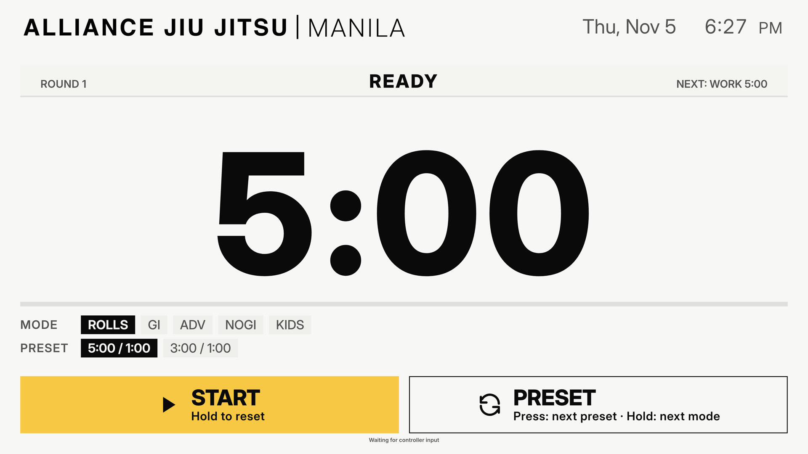

# BJJ Timer

An offline-first BJJ gym timer with physical arcade-button controls and a
fullscreen Electron app for Linux.

[Downloads](https://github.com/ryanyam/bjj-timer/releases) ·
[Issues](https://github.com/ryanyam/bjj-timer/issues) ·
[Deployment guide](DESKTOP.md) ·
[Changelog](CHANGELOG.md)



_1920×1080 Ready screen captured from the Electron renderer. This is a
development capture, not an Ubuntu, TV, or physical-controller validation._

The current source/package version is **0.1.0-beta.6**. A beta.6 Linux x86-64
AppImage has been prepared locally for gym testing; publication of a GitHub
release is not verified in this repository. Use the [Releases
page](https://github.com/ryanyam/bjj-timer/releases) for published downloads.

## What it does

BJJ Timer runs continuous work/rest rounds on a landscape TV. The packaged
target is a **Linux x86-64 AppImage** for the Ubuntu Intel Acer Chromebox. The
app uses local assets and does not need a development server or internet
connection at runtime.

The current interface includes:

- Rolls, gi, advanced, no-gi, and kids training modes with the presets below.
- Start, pause, resume, and hold-to-reset operation.
- Physical USB gamepad/arcade-button support using the browser Gamepad API.
- Visual press, hold-progress, locked-state, and controller-status feedback.
- Active audio: round-start and round-end cues only. Button-action sounds,
  warning beeps, rest beeps, and a session-end cue are not active.
- Local bundled fonts, logo, icons, and audio assets.
- Per-mode Get Ready durations saved locally through the non-public `#settings`
  view. Audio mute/volume values are stored locally but have no public UI.
  Mode and preset selection is session-only.

## Training modes

| Mode  | Presets (work / rest)                              | Default on entry |
| ----- | -------------------------------------------------- | ---------------- |
| ROLLS | 5:00 / 1:00; 3:00 / 1:00                           | 5:00 / 1:00      |
| GI    | 2:00 / 0:30; 3:00 / 0:30; 5:00 / 0:30; 1:00 / 0:30 | 2:00 / 0:30      |
| ADV   | 5:00 / 0:15; 7:00 / 0:15; 3:00 / 0:15              | 5:00 / 0:15      |
| NOGI  | 1:00 / 0:10; 2:00 / 0:10; 3:00 / 0:10; 5:00 / 0:10 | 3:00 / 0:10      |
| KIDS  | 0:30 / 0:05                                        | 0:30 / 0:05      |

Modes cycle in the order **ROLLS → GI → ADV → NOGI → KIDS → ROLLS**.
Work and rest repeat indefinitely; there is no fixed final round or finished
state. Rest does not increment the round. Reset returns to Ready at round 1
with the selected mode and preset preserved.

## Controls

| Input           | Short press                                                | Hold                                                     |
| --------------- | ---------------------------------------------------------- | -------------------------------------------------------- |
| Green MAIN / B0 | Start from Ready; pause while running; resume while paused | Hold **1.5 s** to reset the session to Ready and round 1 |
| White MODE / B1 | While Ready, advance to the next preset                    | Hold **0.8 s** while Ready to advance to the next mode   |

During the Get Ready countdown, a green short press cancels back to Ready.
Mode and preset changes are available only while Ready. While running or
paused, the white control is locked and the selection controls are unavailable;
use the green hold to reset before changing them. The on-screen Start/Pause/
Resume and Preset controls use the same application actions as the arcade
buttons.

## Audio

The active cues are the local `round_start.wav` and `round_end.wav` files:
one when a work phase begins and one when a work phase ends and rest begins.
The Get Ready countdown is silent until work starts. Audio setup failures show
a non-blocking warning; the timer continues.

## Ubuntu / AppImage

Download the current prerelease from
[Releases](https://github.com/ryanyam/bjj-timer/releases), or build it from
source. The locally built beta.4 file has this verified checksum:

```text
d0d9466b0cb2671a5ef0fb621f440e8b1f13839145d7e79b3fef4471f1227744
```

To verify and launch on Ubuntu x86-64:

```sh
sha256sum BJJ-Timer-0.1.0-beta.6-x86_64.AppImage
chmod +x BJJ-Timer-0.1.0-beta.6-x86_64.AppImage
./BJJ-Timer-0.1.0-beta.6-x86_64.AppImage
```

The checksum above applies to the locally prepared artifact, not to a
GitHub-hosted file unless the published asset matches it. If AppImage execution
needs FUSE 2, install the distribution's compatibility package first (for
example `libfuse2` on Ubuntu 22.04+). Kiosk mode exits with **Ctrl+Shift+Q**.

See [DESKTOP.md](DESKTOP.md) for USB transfer, kiosk, offline, and maintenance
details rather than duplicating the full deployment guide here.

## Development

```sh
npm install
npm run dev           # browser development server
npm test              # automated tests
npm run lint          # ESLint
npm run build         # type-check and production web build
npm run desktop:dev   # Vite + windowed Electron development
npm run desktop:build # Linux x86-64 AppImage
npm run desktop:dir   # unpacked Electron directory build
```

Electron settings use `~/.config/bjj-timer/`. The non-public `#settings` view
configures Get Ready durations. Release history is in [CHANGELOG.md](CHANGELOG.md).

## Project status

Beta software for gym testing. Automated tests, lint, and builds do not prove
Ubuntu runtime, physical-controller, audio-output, offline-runtime,
TV-readability, or long-session behavior. Those checks remain pending on the
actual gym hardware.

The app is intended for landscape 16:9 TV displays at 1920×1080, 2560×1440,
and 3840×2160.
